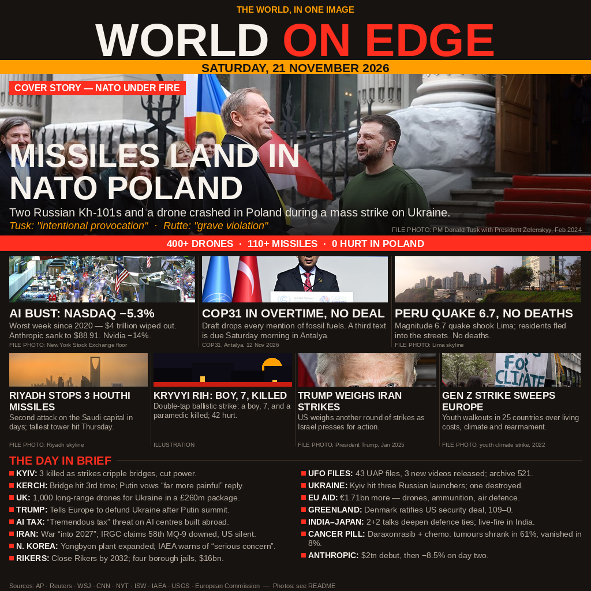

# The World in One Page — 21 November 2026

Entry for the make.fun competition
[news-image-20261121](https://make.fun/c/news-image-20261121):
"Sum up 21 November's world news in one image".

## The image

A magazine cover, not a broadsheet: one dominant cover story, four
supporting stories, and a briefs strip — 13 stories from Saturday
21 November 2026, all verified against wire reporting that morning.

**Cover story — Missiles land in NATO Poland.** Two Russian Kh-101
cruise missiles and a jet-powered drone crashed in south-east Poland
(Nowy Lipowiec, Rudnik nad Sanem, Mołodycz) during a mass Russian
strike on Ukraine: 400+ drones, 110+ missiles. PM Donald Tusk called
it an "intentional provocation"; NATO Secretary-General Mark Rutte
called it a "grave violation". No casualties in Poland.

**Supporting stories**

- **AI bust: Nasdaq −5.3%.** Worst week since March 2020 — $4
  trillion wiped out. Anthropic sank to $88.91, near its $83 IPO
  price. Nvidia −14%.
- **COP31 in overtime, no deal.** The draft drops every mention of
  fossil fuels; a third text was due Saturday morning in Antalya.
- **Riyadh stops 3 Houthi missiles.** Second attack on the Saudi
  capital in days, after its tallest tower was hit on Thursday.
- **Kryvyi Rih: boy, 7, killed.** Double-tap ballistic strike on
  central Kryvyi Rih: a boy, 7, and a paramedic killed; 42 hurt.

**The day in brief**

- Trump: "tremendous tax" threat on AI centres abroad.
- Iran: strike decision off until 2027; deployments extended.
- Rikers: close Rikers by 2032; four borough jails, $16bn.
- UFO files: 43 UAP files, 3 new videos released; archive 521.
- Ukraine: Kyiv hit three Russian launchers; one destroyed.
- EU aid: €1.71bn more — drones, ammunition, air defence.
- Greenland: Denmark ratifies US security deal, 109–0.
- India–Japan: 2+2 talks deepen defence ties; live-fire in India.

Sources: AP, Reuters, WSJ, CNN, ISW, European Commission, NYC.gov,
war.gov.

## How it works

`main.py` (Python 3.13, standard library only) copies the
pre-rendered `entry.png` into `$MAKEFUN_OUTPUT_DIR` (or `/output`,
or the current directory) and prints its sha256. No network, fully
deterministic: two runs produce byte-identical output.

`render_image.py` is the renderer that drew `entry.png` with PIL
from the photos in `photos/` plus one flat illustration (the Kryvyi
Rih night scene, captioned ILLUSTRATION in the image). Fonts are
vendored Liberation Serif/Sans in `fonts/`.

## Photo credits

All photos are from Wikimedia Commons, fetched fresh for this entry,
with their licences verified on the file page. Photos that are not
from the exact event are captioned FILE PHOTO in the image.

1. `photos/cover_tusk.jpg` — "Donald Tusk, Volodymyr Zelenskyy 1
   (2024).jpg", Kancelaria Premiera (Chancellery of the Prime
   Minister of Poland), CC BY 3.0 PL, 22 February 2024.
   https://commons.wikimedia.org/wiki/File:Donald_Tusk,_Volodymyr_Zelenskyy_1_(2024).jpg
2. `photos/nyse.jpg` — "No Known Restrictions Trading Floor, New
   York Stock Exchange (Highsmith LOC) (6718386525).jpg", Carol M.
   Highsmith, public domain (Library of Congress), 10 July 2011.
   https://commons.wikimedia.org/wiki/File:No_Known_Restrictions_Trading_Floor,_New_York_Stock_Exchange_(Highsmith_LOC)_(6718386525).jpg
3. `photos/riyadh.jpg` — "Riyadh Skyline showing the King Abdullah
   Financial District (KAFD) and the famous Kingdom Tower .jpg",
   B.alotaby, CC BY-SA 4.0, 3 April 2016.
   https://commons.wikimedia.org/wiki/File:Riyadh_Skyline_showing_the_King_Abdullah_Financial_District_(KAFD)_and_the_famous_Kingdom_Tower_.jpg
4. `photos/cop31.jpg` — "Tarique Rahman addressing the United
   Nations Climate Change Conference COP31 in Antalya, Turkey,
   2026-11-12.jpg", public domain, 12 November 2026.
   https://commons.wikimedia.org/wiki/File:Tarique_Rahman_addressing_the_United_Nations_Climate_Change_Conference_COP31_in_Antalya,_Turkey,_2026-11-12.jpg

## Licence

MIT — see LICENSE.
